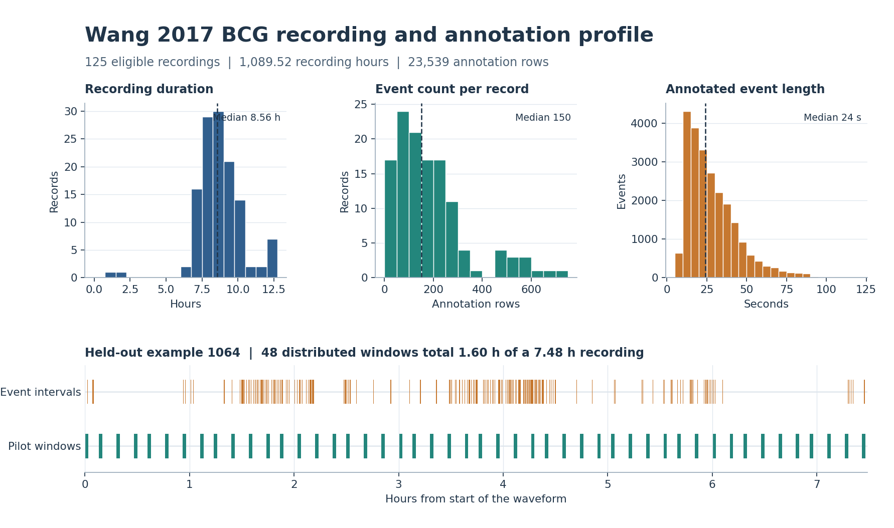

# Wang 2017 床垫 BCG 数据统计与分析报告

**Pilot 每人 1.6 小时是模型评分时长。** 我们在每位测试受试者的完整波形中等距抽取 48 个互不重叠的 120 秒窗口。Figshare 提供一晚波形及沿记录时间轴的呼吸事件区间。发布包用事件表记录正例，并未提供逐秒评分覆盖掩码。因此可以核对事件在哪里标出，以及哪些区间被 pilot 评分。 [Pilot 配置](wang2017-bcg-pilot.md) · [Figshare v3](https://api.figshare.com/v2/articles/4868102/versions/3)

## 数据来源与论文队列

项目简称 **Wang 2017 床垫 BCG**。Figshare 的正式数据名为 *Assessing the Severity of Sleep Apnea Syndrome Based on Ballistocardiogram (BCG)*，使用 **v3**，DOI 为 `10.6084/m9.figshare.4868102.v3`，许可为 CC BY 4.0。数据对应 Wang 等人在 2017 年发表的 PLOS ONE 论文。 [数据集](https://doi.org/10.6084/m9.figshare.4868102.v3) · [论文](https://doi.org/10.1371/journal.pone.0175351)

原研究每人采集一晚。床垫压力传感器记录 BCG，研究团队同步采集 PSG，由睡眠专家标注呼吸事件。年龄、BMI 和 AHI 按论文 Table 1 列出。 [论文采集方法](https://pmc.ncbi.nlm.nih.gov/articles/PMC5405918/#sec006) · [Table 1](https://doi.org/10.1371/journal.pone.0175351.t001)

| 论文队列 | 人数 | 男／女 | 年龄（岁） | BMI（kg/m²） | 参考 AHI（次／睡眠小时） |
| --- | ---: | ---: | ---: | ---: | ---: |
| 全部 | 136 | 84／52 | 53.1 ± 5.1 | 26.9 ± 4.0 | 19.6 ± 15.4 |
| 健康对照 | 41 | 26／15 | 47.8 ± 4.2 | 22.9 ± 2.2 | 2.4 ± 1.3 |
| 轻度 | 23 | 14／9 | 54.0 ± 4.1 | 24.8 ± 2.4 | 11.1 ± 4.4 |
| 中度 | 34 | 20／14 | 54.6 ± 3.3 | 28.9 ± 2.4 | 23.9 ± 2.8 |
| 重度 | 38 | 24／14 | 56.9 ± 3.0 | 30.8 ± 2.0 | 39.5 ± 7.1 |

论文的方法用小波分析提取并校正 RR 间期，以 Physio_ICSS 找候选区间，再用分类器识别事件。原论文的 AHI 实验剔除了清醒期，并按完整的 1 小时睡眠片段计算。文中约 6–9 小时描述的是研究睡眠时长，以下本地统计使用波形样本数换算的记录时长。 [论文实验设置](https://pmc.ncbi.nlm.nih.gov/articles/PMC5405918/#sec012)

## v3 实际下载与可用队列

本地文件为 `/scratch/s5415436/data/BCG/wang2017_bcg_v3_partial.zip`。每条可用波形为单通道 100 Hz MATLAB 向量。`SASEvents*.mat` 以每行一个事件保存 `Number`、`Time`、`Length (s)`、`Pos` 和 `Len`，其中 `1013` 另含一列事件类型。按 `Pos` 和 `Len` 映射时，所有已配对的事件区间都落在对应波形时长内。 [v3 文件核对与保留规则](wang2017-bcg-audit.md) · [逐条清单](wang2017-bcg-cohort.csv)

| 数据口径 | 受试者记录 | 事件表行数 | 波形时长合计 |
| --- | ---: | ---: | ---: |
| v3 本地事件表 | 136 | 26,071 | — |
| 波形与事件表可配对 | 131 | 24,549 | 1,135.58 h |
| 去除 3 条波形重复副本 | 128 | 23,880 | 1,109.95 h |
| 再暂缓 3 条时钟对齐异常记录 | **125** | **23,539** | **1,089.52 h** |

缺波形的 ID 是 `1058、1062、1084、1098、1123`。重复副本为 `1002、1014、1017`，已保留对应的 `1001、1013、1016`。按文件名起录时钟映射后出现越界的 `1018、1086、1105` 暂缓进入首轮队列。`1021` 和 `1136` 的可用波形仅 2.19 h 和 0.85 h，目前仍用于区间级事件实验。 [质量检查依据](wang2017-bcg-audit.md)

**论文与 v3 事件计数有 8,125 条差异。** 论文的实验设置报告了 **17,946 个标为呼吸事件的片段**，本地 v3 的 136 份 `SASEvents` 表共有 **26,071 行**，已用 MATLAB 表头计数和加载后计数交叉核对。论文的实验筛选与公开文件之间缺少逐事件对应表，差异原因待核实。论文严重度人数只用于描述其研究队列。 [论文实验设置](https://pmc.ncbi.nlm.nih.gov/articles/PMC5405918/#sec012)

## 125 条记录的分布

| 指标 | 中位数 | 第 25–75 百分位 | 最小–最大 |
| --- | ---: | ---: | ---: |
| 每条波形记录时长 | 8.56 h | 7.91–9.62 h | 0.85–12.15 h |
| 每条记录的事件表行数 | 150 | 78–247 | 2–713 |
| 单个标注事件的长度 | 24 s | 16–36 s | 7–116 s |
| 标注事件秒占记录时长 | 14.8% | 7.0%–20.4% | 0.2%–68.7% |
| 每记录小时的标注事件数 | 18.07 | 9.99–28.65 | 0.26–84.01 |

23,539 个区间的并集合计 **181.69 小时**，占 125 条波形总时长的 **16.7%**。其中 **638 条（2.7%）短于 10 秒**。这部分真值在评估时应保留计数，尤其是采用 BCGNet 的最短预测事件过滤规则时。记录级事件负荷跨度较大，按受试者统计可看出低事件量记录的表现。 [BCGNet 后处理调研](bcgnet-patient-level-evaluation.md)

## Pilot 的实际覆盖范围

先前的 smoke 是两条训练侧记录各取一个窗口，验证读入、模型和 checkpoint。这里讨论的是其后的 **32 人轻量训练和独立测试**，按受试者拆为训练／验证／测试 **24／4／4**。每位测试受试者评估 48 窗，共 1.60 小时。 [固定拆分](wang2017-bcg-pilot-split.csv) · [Pilot 结果](wang2017-bcg-pilot.md)

| 测试 ID | 原始波形时长 | 开发测试评分时长 | 波形覆盖 | 整条记录的标注事件 | 整条记录的标注事件秒 | 抽窗内的标注事件秒 |
| --- | ---: | ---: | ---: | ---: | ---: | ---: |
| `1016` | 9.06 h | 1.60 h | 17.7% | 267 | 6,288 | 1,322 |
| `1064` | 7.48 h | 1.60 h | 21.4% | 243 | 3,718 | 789 |
| `1100` | 9.82 h | 1.60 h | 16.3% | 583 | 23,277 | 3,667 |
| `1113` | 7.37 h | 1.60 h | 21.7% | 27 | 386 | 41 |

以 `1064` 为例，记录持续 **26,942 秒**，最后一条事件标注结束于 **26,847 秒**。图中橙色条来自整条记录的事件表，绿色条是 pilot 选中的 48 个窗口。这个区别直接影响指标口径。现有 AUPRC 评估的是抽窗内的逐秒预测，患者级事件总量需要用现有 checkpoint 对整条波形推理后再统计。

## 对后续实验的含义

- **整晚 BCG 事件检测。** 可使用 125 条队列做按受试者拆分的整条记录评估。用相同的有效记录时长计算参考和预测的每记录小时事件数，可画 BCGNet Fig. 3–4 风格的配对图。每记录小时的事件率取决于波形录制时长和事件标注口径。 [患者级评估调研](bcgnet-patient-level-evaluation.md)
- **临床 AHI、睡眠分期和严重度。** 需要补齐能按 ID 连接的 PSG 参考 AHI、总睡眠时间或分期及适用的事件评分定义。论文的分组合计可用来描述原队列，v3 提供的是波形和事件区间。 [论文](https://doi.org/10.1371/journal.pone.0175351) · [Figshare v3 文件清单](https://api.figshare.com/v2/articles/4868102/versions/3)

统计使用 ZIP 中的 MATLAB 维度除以 100 Hz 计算记录时长，用每张标注表的行数计事件，用半开区间 `[Pos, Pos + Len)` 的并集计事件秒。Pilot 覆盖从已保存的 `subject_id` 和 `start_second` 还原，并与存盘标签逐秒核对。归档文件的 SHA-256 和文件级校验见数据审计。 [数据审计](wang2017-bcg-audit.md)
